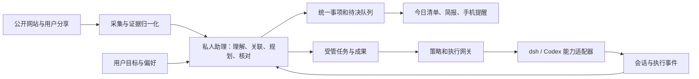

# NightDesk · 拾光哨

**替一个人看住消息、期限和正在进行的工作，把注意力还给本人。**

2026-11-13 设计草案。当前只有产品与工程文档，没有产品代码、已部署服务或已验证的平台集成。任务、消息、标识和结果样例均为合成数据。NightDesk / 拾光哨是创意工作名，不承诺商标或名称唯一。

## 为什么做

使用 dsh、Codex 时，同时维护多个对话意味着反复恢复上下文、阅读方案、决定下一步、处理权限和检查成果。AI 增多后，人可能变成所有会话的调度员。

校园事项也存在类似问题：学习通、校院官网、校院团委、教务网站、微信和 QQ 群及私聊、雨课堂各有消息。错过作业期限、漏掉感兴趣活动的报名窗口，常常发生在信息没有进入可靠工作流的时候。

拾光哨把两条主线接起来：**发现并跟进与你有关的事情；管理你已经委托给 Agent 的工作。** 它理解目标，在明确范围内规划、委派、检查和跟进；需要本人判断时，带着依据、建议和后果来找你。

## 怎么用

用户通过聊天交代目标、修正偏好和追问原因。日常查看今日清单、待决、成果和来源健康，不必阅读所有 worker 对话。简单工作可以不派 worker，普通任务用一个，独立工作按需并行。

- **今日**：哪些事项临近期限、哪些任务正在推进、哪些需要本人行动。
- **待决**：真实阻塞、建议与影响；方案选择和动作授权分开。
- **成果**：经过核对的交付包、来源、验证与限制。
- **来源健康**：最近成功范围、登录失效、漏采区间、通知通道故障。

聊天是控制入口，统一清单是工作入口。产品愿景包含主动发现、目标委托、核对返工和持续跟进，不限于通知摘要或审批卡。

## 文档导航

| 文档 | 重点 |
| --- | --- |
| [产品与交互](docs/01-产品与交互.md) | 场景、助理行为、界面、通知与完成语义 |
| [系统架构](docs/02-系统架构.md) | 组件、模型边界、事件、事务和部署 |
| [数据与接口契约](docs/03-数据与接口契约.md) | 实体、状态、版本、API、幂等 |
| [来源与连接器](docs/04-来源与连接器.md) | 平台可行性、能力探针与降档 |
| [Agent 运行时](docs/05-Agent运行时.md) | 规划、委派、核对、审批、停止 |
| [开发路线与验收](docs/06-开发路线与验收.md) | 依赖、工作包、阶段门和评估 |
| [安全与运维](docs/07-安全与运维.md) | 隐私、恶意输入、恢复、备份 |
| [决策与证据](docs/08-决策与证据.md) | 选择依据、官方资料、未知项与指标 |

## 架构概览

模型负责理解、候选抽取、规划建议和内容核对；确定性内核负责权限、截止调度、版本、预算、重试和记账。模型的自述不能授予权限，也不能证明动作已经完成。

## 开发顺序

1. **P0 验证前提**：真实工作流、金标、来源、手机通道、运行时能力探针。
2. **P1 防漏事**：公开网页和主动分享、时间核对、来源健康、真实手机提醒。
3. **P2 看住 Agent**：至少一个运行时真实只读状态与成果接入统一队列。
4. **P3 受管执行**：任务委派、成果核对、版本控制、最小动作授权。
5. **P4 扩展与实用验证**：更多渠道、可选登录态试验、个人使用和竞赛展示。

P1+P2 才形成双主线最小版本；P3 才提供受管委派能力。当前上述阶段均未实施。

建议单人优先、本地优先的模块化单体：TypeScript、开发时受支持的 Node.js LTS、Fastify、React、SQLite WAL。具体版本和依赖在初始化时固定，不因同栈就假定能复用宿主类型。

## 关键边界

- 未接入来源不计入覆盖；同步失败不显示为没有新事项。
- 没有证据，不断言作业未提交、名额仍有或精确截止。
- 关键期限不因兴趣过滤或普通打断配额消失；提醒也需要去重和有限升级。
- 通知提交、送达、已读与事情完成分开。
- 只读观察、受管任务和受保护动作是不同能力，逐项验证。
- 超时不等于批准；原生宿主保护不能由汇总层绕过。
- 页面关闭后仍需在线宿主。电脑休眠、离线和程序退出会影响持续运行。

## 公开状态和许可

仓库：https://github.com/Names233/nightdesk 。这里发布的是脱敏设计文档，不包含真实学生资料、私人会话、凭据和个人基础设施信息。平台接口与手机通知尚未实测，资料依据见证据文档。

许可待所有者决定，当前未添加 LICENSE；公开可读不等于已按 MIT、CC 或其他许可授权使用。第三方资料保留各自权利。提交问题或案例前请移除个人数据。