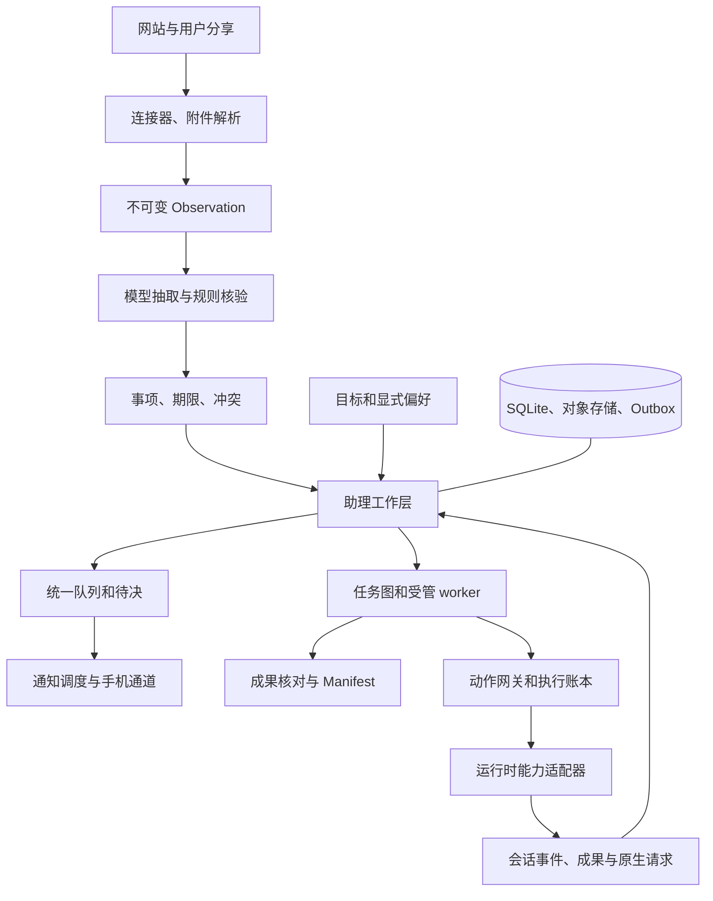
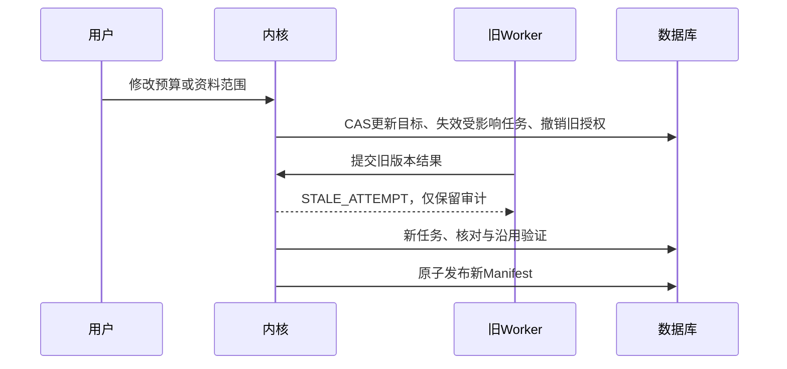

# 02 系统架构

2026-11-13 · 推荐实现草案，未部署或测试。

[首页](../README.md) · [契约](03-数据与接口契约.md) · [运维](07-安全与运维.md)

## 1. 模块化单体

建议 TypeScript、受支持 Node.js LTS、Fastify、React、SQLite WAL。初始化时固定版本、驱动和包管理器。一个代码库、一个服务和一个本地数据库起步，不预设 Redis、消息集群、向量数据库或多租户。

本地优先保护私人数据并减少部署门槛。持续在线有需要时可迁移到常开设备或自有服务器，但不能把本地优先说成所有模型调用均不出设备。

建议模块：sources、observations、items、profiles、goals、runtime、artifacts、decisions、actions、notifications、policy、storage。模块经应用服务和事件交互，不随意跨模块改表。

## 2. 数据流

两条输入线共同服务个人目标。外部会话不直接等于本系统任务：需要区分只读观察、任务归属和实际控制权。

## 3. 模型边界

模型理解意图、抽取候选、提出有界计划、比较内容和给核对建议。结构校验后，由业务规则决定写入状态。模型自述置信度只作调试信息，不作为已校准概率或自动授权依据。

确定性内核拥有身份、归属、调度时钟、版本、租约、预算、重试、授权、停止和审计的最终控制。供应商变化不能改变这些契约。

抽取、规划、核对可以共用模型，但上下文和权限分离。优先使用可验证证据：真实回执、成果哈希、必需字段、需求覆盖；同一回答自称检查过不算独立验证。

## 4. 事件与事务 Outbox

业务更新与待处理事件在一个事务提交。确认期限同时写入期限版本和提醒重算事件；目标变更同时写失效关系和后续调度事件。不能仅依赖进程内回调。

消费者采用至少一次处理，按 eventId、handlerId 唯一去重。事件包括来源更新、事项确认、期限修订、会话待输入、成果提交、授权变化和通知状态变化。载荷优先引用实体与版本，不广播私人原文。

外部网络与数据库不能真正原子提交：先持久化意图，再派发，再记录回执。宕机窗口可能产生未知结果，进入对账；不承诺外部精确一次。

## 5. 调度和资源

领取任务使用事务 CAS，生成租约、leaseOwner 和递增 fencingToken。提交匹配当前任务、目标版本和租约。租约过期不证明旧 worker 已停止，因此旧结果拒绝写当前成果。

模型调用数、token、费用、耗时、并发和返工次数都有上限。调用前预留、结束后结算；价格带版本，无法取得账单时标估算。供应商最终收费上限不能由应用预留额度保证。

模型额度耗尽仍保留规则提醒和已确认事实。失败退避有上限；来源限流不影响其他来源，普通任务不占满截止调度资源。

## 6. 版本与成果

目标更新提高 goalVersion，并沿显式输入字段依赖和任务图计算失效集合。未知依赖保守失效。未受影响的任务也要通过新目标的最终核对，不能直接认为兼容。

Artifact 正文不可变。新版本可以沿用旧成果，但 Manifest 记录原始 producingGoalVersion、新适用版本、再验证依据和验证时间；不能改写旧成果的版本冒充重新生成。

发布 Manifest 与更新当前交付指针为单事务。缺项、验证失败或目标版本变更均整体拒绝。此处发布是应用内交付，不自动授权上传公共网站。

## 7. 版本变化示例

外部 ActionExecution 独立于 worker 生命周期。目标变更、停止或 superseded 都不能抹掉已经派发或未知的副作用。

## 8. 前后台与部署

浏览器不是唯一定时器。后台进程负责采集、截止调度和 Outbox，操作系统服务或用户选定的进程管理方式负责启动。休眠、断网和退出行为写入运行说明。

P1 必须验证一个手机通道在网页关闭和锁屏时可观察工作。Web Push 是候选而非保底，国内网络、系统电池策略和设备权限需要单独测试。

网页与后台可同机，远程访问才添加 TLS 和受控鉴权。手机能看页面与手机能收到通知分别验收。

## 9. 存储与恢复

SQLite 启用外键、合理 busy timeout 和短写事务；迁移有版本和备份。大附件置于受控对象目录，以哈希引用，备份维护数据库与对象共同清单。

WAL 下不能只复制正在使用的主文件。采用 Online Backup API 或经验证的一致性机制，检查外键、对象、账本与 Outbox 后恢复。

从旧备份恢复前，先对照备份后的执行日志或提供方回执；没有证据时隔离不确定动作，不恢复自动派发。提醒补发也要重算当前期限，不能把过期任务盲目重播。