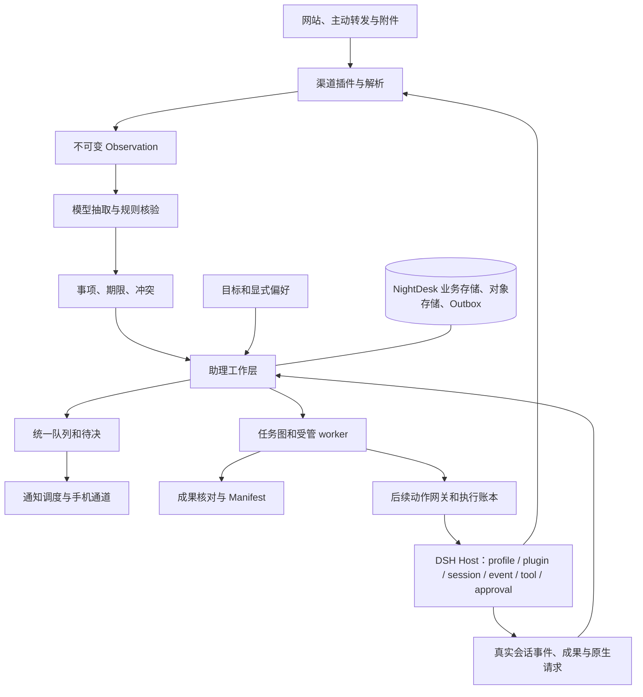
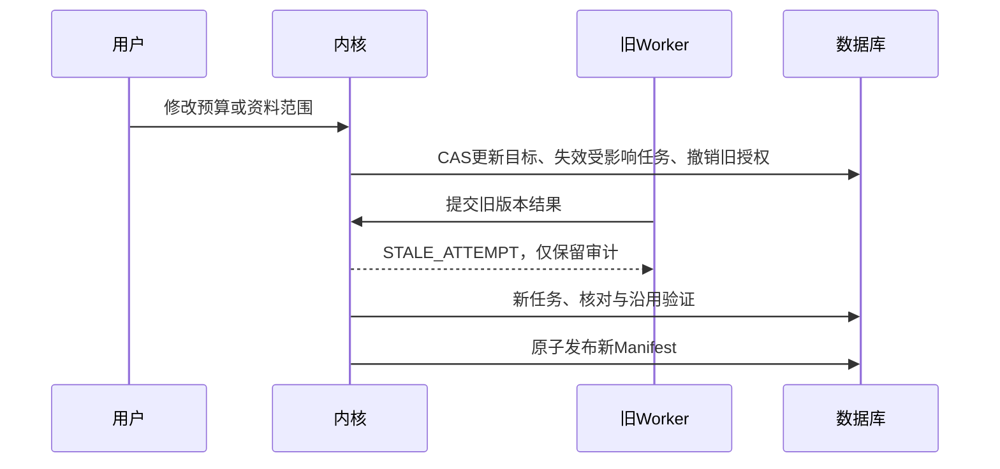

# 02 系统架构

2026-11-13 · 推荐实现草案，未部署或测试。

[首页](../README.md) · [契约](03-数据与接口契约.md) · [运维](07-安全与运维.md)

## 1. DSH 插件化单体

首版采用一个 dsh 业务插件、一个助理 preset 和一个专用 profile，复用宿主的模型配置、会话、工具、审批、停止与子 Agent。今日清单、待决和成果先通过聊天工具查阅；确有持续查看需要时再加轻量工作视图，暂不单独搭建 Fastify、React 服务，也不预设多包工程。

插件内仍按 sources、observations、items、goals、runtime、artifacts、decisions、notifications、policy、storage 划分业务模块，经应用服务和事件交互，不随意跨模块改表。业务数据由插件负责：先验证宿主存储能否满足事项更新与 Outbox 同事务，不能证明时使用插件自有 SQLite WAL，不直接写 dsh 内部数据库。

本地优先保护私人数据并减少部署门槛。持续在线有需要时可迁移到常开设备或自有服务器，但不能把本地优先说成所有模型调用均不出设备。Node.js、TypeScript、依赖和包管理器版本在 D00 固定，不假定可复用宿主未公开类型。

## 2. 数据流

两条输入线共同服务个人目标。外部会话不直接等于本系统任务：需要区分只读观察、任务归属和实际控制权。

## 3. 模型边界

模型理解意图、抽取候选、提出有界计划、比较内容和给核对建议。结构校验后，由业务规则决定写入状态。模型自述置信度只作调试信息，不作为已校准概率或自动授权依据。

宿主与插件的确定性代码拥有身份、归属、调度时钟、版本、预算、重试、授权、停止和审计的最终控制。首版只实现当前阶段需要的保护：v0.1 保证提醒幂等和旧提醒失效，v0.3 保证身份、版本、停止与旧 attempt 拒绝；完整租约、fencingToken 和字段依赖图随通用执行能力扩展验收。供应商变化不能改变这些契约。

抽取、规划、核对可以共用模型，但上下文和权限分离。优先使用可验证证据：真实回执、成果哈希、必需字段、需求覆盖；同一回答自称检查过不算独立验证。

## 4. 事件与事务 Outbox

业务更新与待处理事件在一个事务提交。确认期限同时写入期限版本和提醒重算事件；目标变更同时写失效关系和后续调度事件。不能仅依赖进程内回调。

消费者采用至少一次处理，按 eventId、handlerId 唯一去重。事件包括来源更新、事项确认、期限修订、会话待输入、成果提交、授权变化和通知状态变化。载荷优先引用实体与版本，不广播私人原文。

外部网络与数据库不能真正原子提交：先持久化意图，再派发，再记录回执。宕机窗口可能产生未知结果，进入对账；不承诺外部精确一次。

## 5. 调度和资源

v0.3 使用事务 CAS 匹配当前用户、taskId、attemptId 和 goalVersion，旧结果拒绝写当前成果。通用多 worker 领取再引入租约、leaseOwner 和递增 fencingToken；租约过期不证明旧 worker 已停止，仍不能允许旧提交覆盖。

模型调用数、token、费用、耗时、并发和返工次数都有上限。调用前预留、结束后结算；价格带版本，无法取得账单时标估算。供应商最终收费上限不能由应用预留额度保证。

模型额度耗尽仍保留规则提醒和已确认事实。失败退避有上限；来源限流不影响其他来源，普通任务不占满截止调度资源。

## 6. 版本与成果

目标更新提高 goalVersion。v0.3 至少使相关未完成 attempt 和旧版本交付失效；显式输入字段依赖图与精确失效集合属于后续增强，未知依赖保守失效。未受影响的任务也要通过新目标的最终核对，不能直接认为兼容。

Artifact 正文不可变。后续若允许新版本沿用旧成果，Manifest 必须记录原始 producingGoalVersion、新适用版本、再验证依据和验证时间；不能改写旧成果的版本冒充重新生成。

v0.3 发布 Manifest 与更新当前交付指针为单事务。缺项、验证失败或目标版本变更均整体拒绝。此处发布是应用内本地交付，不自动授权上传公共网站。

## 7. 版本变化示例

外部 ActionExecution 独立于 worker 生命周期。目标变更、停止或 superseded 都不能抹掉已经派发或未知的副作用。

## 8. 前后台与部署

浏览器不是唯一定时器。dsh 宿主与 NightDesk 插件的后台生命周期负责采集、截止调度和 Outbox；D00 必须探针宿主重载、重启与持久任务语义，必要时用受管进程补足，不默认另建服务。休眠、断网和退出行为写入运行说明。

P0 先探针一个真实手机通道，P1 必须验证它在网页关闭、锁屏、重启和断网恢复后的可观察工作。Web Push 是候选而非保底，国内网络、系统电池策略和设备权限需要单独测试；QQ 先、微信独立探针。

网页与后台可同机，远程访问才添加 TLS 和受控鉴权。手机能看页面与手机能收到通知分别验收。

## 9. 存储与恢复

D00 优先探针 dsh 为插件提供的持久化与事务能力；NightDesk 不直接写宿主内部数据库。只有宿主无法保证事项更新与 Outbox 同事务时，才引入插件自有 SQLite。存储选型与迁移必须有版本和备份，大附件置于受控对象目录，以哈希引用，备份维护数据库与对象共同清单。

采用 SQLite 时启用外键、合理 busy timeout、短写事务和 WAL；WAL 下不能只复制正在使用的主文件，采用 Online Backup API 或经验证的一致性机制，检查外键、对象、账本与 Outbox 后恢复。

从旧备份恢复前，先对照备份后的事项、Outbox、执行日志或提供方回执；没有证据时隔离不确定动作，不恢复自动派发。提醒补发也要重算当前期限，不能把过期任务盲目重播。

## 10. DSH 宿主与插件边界

DSH 是 Agent 宿主层：profile 负责隔离，plugin 负责渠道和工具，session 承载会话，event 传播状态，approval 保留宿主审批。NightDesk 通过固定版本后实测的插件与事件契约连接 dsh，不直接写宿主内部数据库。Codex 是外部桥接能力，QQ／微信主动转发和未来学习平台只读连接器都必须沿同一边界进入。
